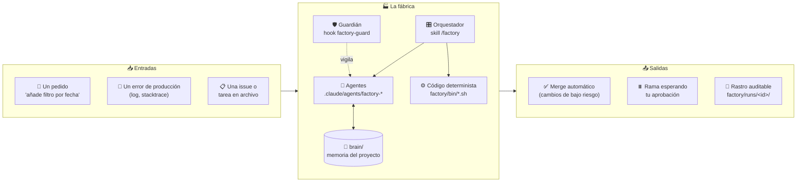
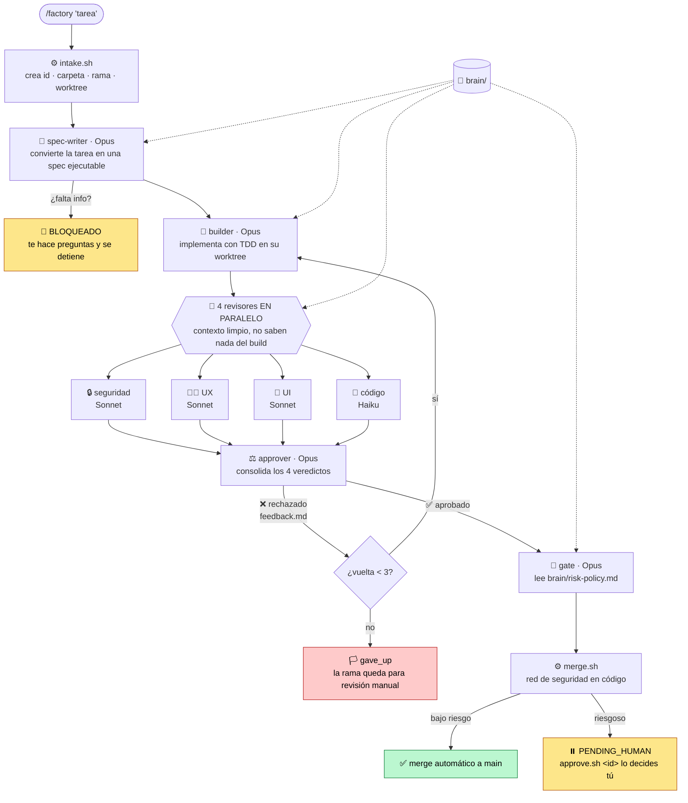
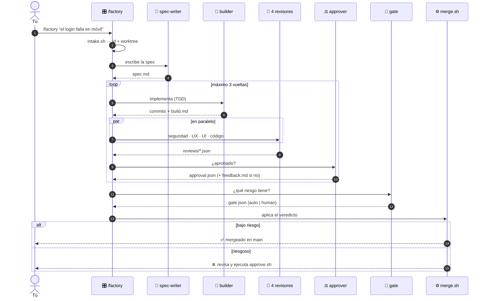
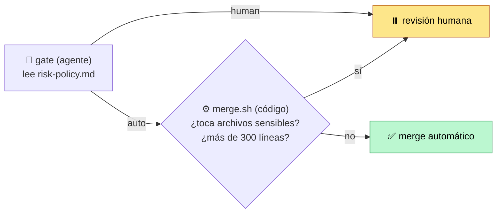
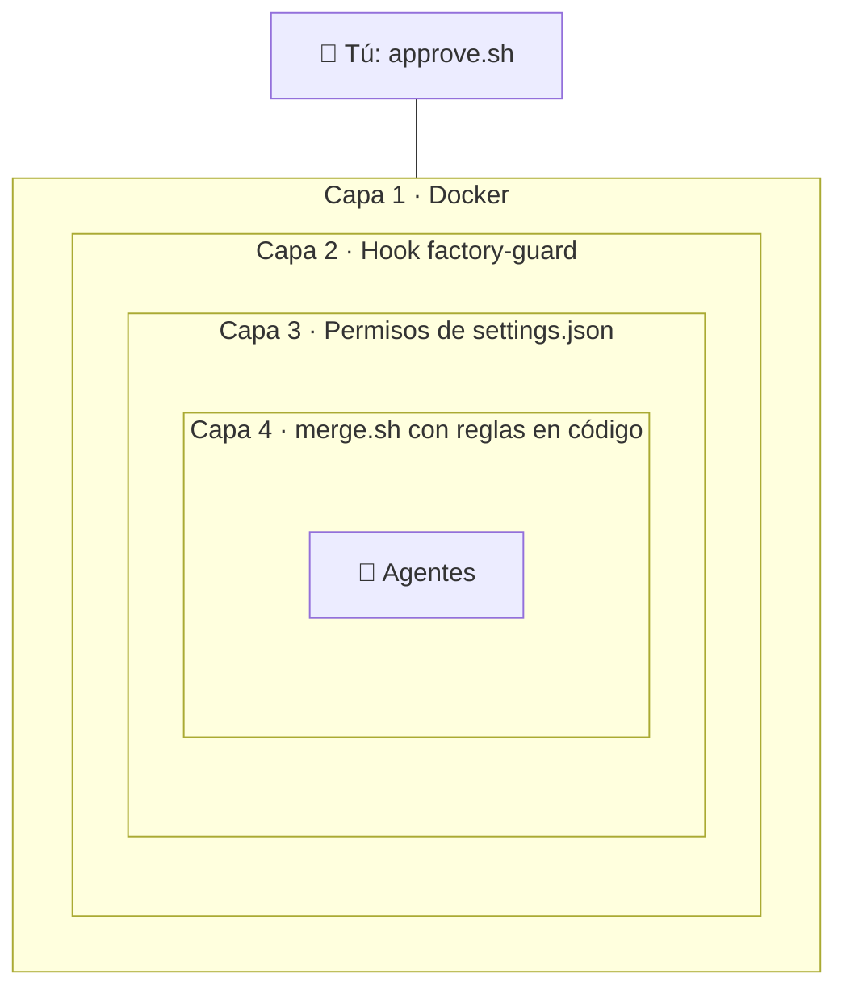
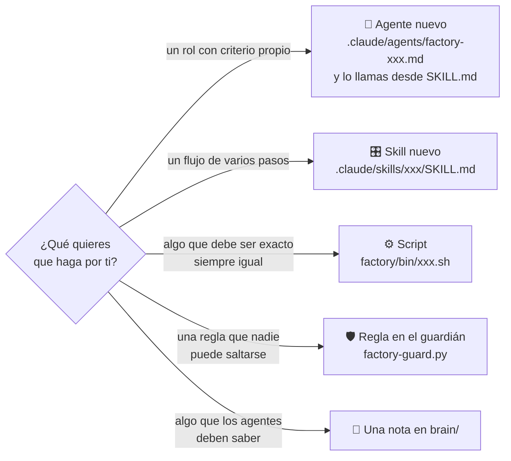

# 🏭 Factory: una Software Factory para Claude Code

> **Le das una tarea y te devuelve código revisado y mergeado**, o una rama esperando tu firma.
> No es un solo agente. Es un **ecosistema**: un lugar donde vamos poniendo las piezas (agentes, skills, scripts, memoria y reglas) que hacen el trabajo por nosotros, cada una con su rol y con controles entre ellas.

---

## 🧭 El ecosistema de un vistazo



| Capa | Qué es | Quién la controla |
|---|---|---|
| 🧠 **Brain** | Memoria del proyecto: arquitectura, convenciones, producto, decisiones y política de riesgo. Todos los agentes la leen antes de actuar. | Tú (y los agentes añaden decisiones) |
| 🤖 **Agentes** | Especialistas con un solo trabajo cada uno y el modelo justo para ese trabajo | El orquestador |
| 🎛️ **Orquestador** | El skill `/factory`: no escribe código, solo delega y comprueba que cada paso dejó su archivo | — |
| ⚙️ **Código determinista** | Scripts bash que hacen lo que no debe depender de un LLM: crear la tarea, mergear y aprobar | Reglas fijas en código |
| 🛡️ **Guardián** | Hook que impide a los agentes hacer merge, push, autoaprobarse o tocar la política de riesgo | Solo tú |
| 🙋 **Humano** | La última palabra en lo que es riesgoso | Tú |

---

## 🔄 Cómo fluye una tarea



### La misma tarea, contada en el tiempo



---

## 🚦 ¿Quién decide si se mergea solo?

Dos filtros independientes. Para ir por la vía rápida, el cambio tiene que pasar **los dos**: no basta con que el agente diga "auto".



| ✅ Vía rápida | ⏸️ Siempre humano |
|---|---|
| Textos, estilos, colores, copys | Esquema de BD, migraciones, borrados masivos |
| Tests nuevos sin cambio de lógica | Auth, pagos, secretos |
| Documentación | Lógica core de negocio |
| | Dependencias nuevas, Docker, CI/CD |
| | Más de ~300 líneas o 10 archivos |

*Ante la duda: revisión humana.* Esta política la editas tú en `brain/risk-policy.md`, y los agentes tienen prohibido tocarla.

---

## 🛡️ Por qué es seguro dejarla trabajar sola



- **Docker**: la fábrica corre en un contenedor con `bypassPermissions`. Si algo sale mal, se queda dentro del contenedor.
- **Guardián**: bloquea `git merge/push/rebase/reset --hard`, el cambio a `main`, la ejecución de `approve.sh` y la edición de `risk-policy.md`, de los hooks o de los settings.
- **Permisos**: `git push` y `approve.sh` están en `deny`.
- **Worktrees**: cada tarea trabaja en su propia copia (`.worktrees/<id>`), así que `main` no se toca hasta el merge.

---

## 🤖 El equipo

| Agente | Modelo | Rol |
|---|---|---|
| `factory-spec-writer` | Opus | Convierte la entrada en una spec ejecutable consultando el brain. Si falta información, se bloquea y pregunta. |
| `factory-builder` | Opus | Implementa la spec con TDD dentro del worktree de la tarea |
| `factory-reviewer-security` | Sonnet | Busca vulnerabilidades, secretos e inyecciones |
| `factory-reviewer-ux` | Sonnet | Compara el cambio con los flujos de `brain/product.md` |
| `factory-reviewer-ui` | Sonnet | Revisa consistencia visual y accesibilidad |
| `factory-reviewer-code` | Haiku | Revisa calidad y consistencia del código (barato y rápido) |
| `factory-approver` | Opus | Consolida los 4 veredictos. Si rechaza, escribe `feedback.md` para el builder. |
| `factory-gate` | Opus | Decide vía rápida o humana según la política de riesgo |

---

## 🚀 Instalar en tu proyecto

```bash
git clone git@github.com:EstebanAdarico/factory.git
cd factory
./setup.sh /ruta/a/mi-proyecto       # copia las piezas sin pisar nada que ya exista
```

Luego, dentro de tu proyecto (estos pasos los haces **tú**, a propósito):

```bash
factory/install/install.sh           # activa el guardián y los permisos
# rellena brain/: architecture.md, product.md y risk-policy.md
git add -A && git commit -m "Añadir Software Factory"
```

**Con Docker (recomendado para el modo autónomo):**

```bash
cp compose.example.yml compose.yml   # ajústalo a tu stack
docker compose up -d --build
docker compose exec factory claude   # la primera vez: login
```

## 🕹️ Uso

| Quiero… | Comando |
|---|---|
| Lanzar una tarea (interactivo) | `/factory "el botón de login no responde en móvil"` dentro de `claude` |
| Retomar una tarea | `/factory <run-id>` |
| Lanzar varias en paralelo (headless) | `factory/bin/run.sh "tarea 1"` · `factory/bin/run.sh "tarea 2"` |
| Lanzar desde un log o una issue | `factory/bin/run.sh --file error.txt` |
| Ver el estado de todo | `factory/bin/status.sh` |
| Aprobar o rechazar | `factory/bin/approve.sh <id>` · `factory/bin/approve.sh <id> --reject` |

## 📂 Qué queda guardado de cada tarea

```
factory/runs/<id>/
├── input.md          📥 lo que pediste
├── spec.md           📝 qué se va a hacer y cómo se valida
├── build.md          🔨 qué hizo el builder
├── reviews/          👀 security.json · ux.json · ui.json · code.json
├── feedback.md       🔁 por qué se rechazó (si hubo vueltas)
├── approval.json     ⚖️ veredicto del aprobador
├── gate.json         🚦 vía rápida o humana, y por qué
├── log.jsonl         🕓 cada evento con hora
└── session.log       🖥️ salida completa (modo headless)
```

## 🗂️ Estructura del repo

```
.
├── .claude/
│   ├── agents/factory-*.md      🤖 los 8 agentes
│   └── skills/factory/SKILL.md  🎛️ el orquestador /factory
├── brain/                       🧠 plantillas de memoria (rellénalas por proyecto)
├── factory/
│   ├── bin/                     ⚙️ intake · run · status · merge · approve
│   ├── install/                 🛡️ guardián + settings (los activa install.sh)
│   ├── tasks/                   📋 tareas escritas para lanzar con --file
│   └── runs/                    📂 rastro de cada corrida (fuera de git)
├── docker/factory.Dockerfile    🐳 Claude Code + Python + Node + git, sin root
├── compose.example.yml
└── setup.sh                     🚀 instala la fábrica en otro proyecto
```

---

## 🌱 Hacer crecer el ecosistema

La idea es que la fábrica vaya ganando piezas. Para añadir una:



**Regla de oro:** si un paso debe ser exacto y repetible, va en **código**. Si necesita criterio, va en un **agente**. Si es riesgoso, la decisión es **tuya**.

---

<sub>Inspirado en *"Programar con agentes ya no basta: monta tu Software Factory"* (Eric Risco).</sub>
